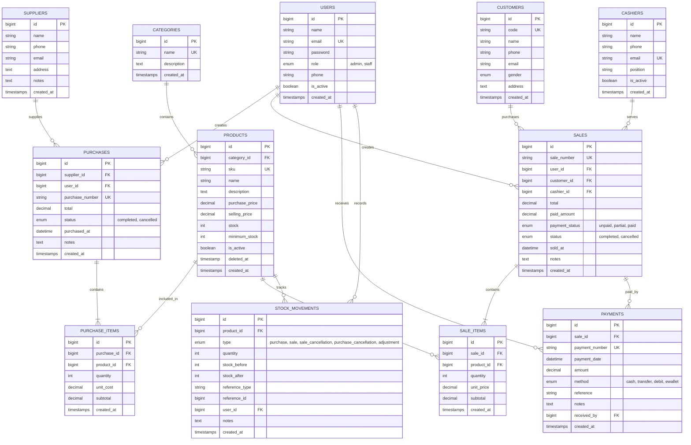

# PhoneGear Store — Inventory & Sales Management System
### Integrated Laravel Inventory & Sales Management System — UTS Web Programming 2

Aplikasi web terintegrasi berbasis **Laravel** dan **MySQL** untuk toko ritel aksesoris handphone (**PhoneGear Store**), dirancang untuk mengelola seluruh siklus operasional bisnis: autentikasi berbasis peran (*Role-Based Access Control*), katalog produk & kategori aksesoris, manajemen pemasok & pelanggan, transaksi pengadaan stok (*Stock-In*), kasir penjualan (*POS / Stock-Out*), pencatatan pembayaran cicilan/lunas, pemantauan stok menipis, serta 3 laporan komprehensif (Penjualan, Pembelian, dan Stok Valuasi Aset).

---

## 1. Gambaran Umum & Arsitektur Sistem

Aplikasi ini menerapkan standar arsitektur berlapis (*layered architecture*) Laravel yang bersih dan aman:

```
Browser (HTTP Request)
   ↓
Route (routes/web.php)
   ↓
Middleware (auth, role:admin,owner)
   ↓
Controller (SaleController, PurchaseController, dll.)
   ↓
Form Request / Server-side Validation
   ↓
Service / Business Logic Layer (SaleService, PurchaseService)
   ↓
Eloquent ORM (Model & Relations)
   ↓
Database (MySQL / MariaDB)
   ↓
Blade View Response (Modern Navy Blue Theme)
```

### Prinsip Utama Business Logic:
1. **Integritas Transaksi Atomik (`DB::transaction`)**: Seluruh operasi header transaksi, item detail, dan mutasi stok dibungkus dalam transaksi database. Jika salah satu item gagal (misal kuantitas melebihi stok yang ada), seluruh transaksi di-rollback tanpa meninggalkan data parsial.
2. **Pencegahan Overselling & Race Condition (`lockForUpdate()`)**: Menggunakan mekanisme *pessimistic locking* pada tabel produk saat pengecekan dan pengurangan stok penjualan, mencegah terjadinya stok minus ketika ada transaksi bersamaan (*concurrency*).
3. **Kalkulasi Server-Side**: Harga satuan dan total tagihan selalu dihitung dan divalidasi di server berdasarkan database, bukan mempercayai input dari browser.
4. **Isolasi Pembayaran & Stok**: Pencatatan pembayaran sebagian (*partial*) maupun pelunasan (*full settlement*) dipisahkan dari mutasi stok, memastikan stok tidak berkurang ganda saat pembayaran dicatat.
5. **Pemulihan Stok Aman Saat Pembatalan (*Cancellation Safety*)**: Pembatalan transaksi penjualan memulihkan stok secara aman dan hanya dapat dilakukan satu kali (terproteksi dari *double restoration*).
6. **Perlindungan Data Historis (*Soft Deletes*)**: Produk yang telah memiliki riwayat penjualan atau pembelian dilindungi dari *hard delete* agar tidak merusak rekam jejak keuangan dan audit mutasi stok.

---

## 2. Fitur Utama Aplikasi

### A. Autentikasi & Hak Akses (Role-Based Access Control)
- **Role Admin / Owner**:
  - Mengelola data akun pengguna (buat staf baru, ganti role, toggle status aktif).
  - Akses penuh CRUD Kategori, Produk, Pemasok, Pelanggan, dan Kasir.
  - Membatalkan transaksi penjualan atau pembelian stok dengan alasan pembatalan.
  - Mengakses laporan penjualan, rekap harian, dan ringkasan produk terlaris.
- **Role Staff / Kasir**:
  - Melihat katalog produk dan ketersediaan stok aktual.
  - Membuat transaksi pengadaan/pembelian stok (*Stock-In*).
  - Melakukan transaksi penjualan (*Point of Sale*) dan mencetak nota.
  - Mencatat pembayaran pelanggan (tunai, transfer bank, debit, e-wallet).
  - Terproteksi secara server-side dari menu administrasi dan kelola pengguna.

### B. Dashboard Real-Time
- Menampilkan data agregat aktual dari database (tanpa angka statis/dummy):
  - Total Produk, Kategori, Pemasok, dan Pelanggan.
  - Total Akumulasi Transaksi Penjualan.
  - Pendapatan Hari Ini dan Pendapatan Bulan Ini (format Rupiah `Rp`).
  - Indikator peringatan produk stok menipis dan produk habis (`stok = 0`).
  - Tabel transaksi penjualan dan pembelian terbaru.

### C. Manajemen Master Data
- **Kategori Produk**: CRUD kategori aksesoris, validasi nama unik, proteksi hapus jika kategori masih memuat produk.
- **Katalog Produk Aksesoris**:
  - Kode SKU unik, nama produk, kategori, deskripsi, harga beli (modal), harga jual (eceran), stok fisik, batas minimum stok, dan status aktif.
  - Contoh katalog: *Casing iPhone, Casing Samsung, Tempered Glass 9D, Privacy Screen, Fast Charger GaN, Kabel Data USB-C, Kabel Lightning, TWS Bluetooth, Phone Holder, Power Bank, Ring Holder*.
  - Validasi harga dan stok tidak boleh negatif (`min:0`).
  - Pencarian berdasarkan SKU atau nama produk, filter kategori, dan pagination.
- **Pemasok (Supplier)**: CRUD data distributor, nama, nomor telepon, email, alamat gudang, catatan mitra, serta proteksi penghapusan jika memiliki relasi transaksi pembelian.
- **Pelanggan (Customer)**: CRUD data pelanggan, nomor telepon, email, jenis kelamin, alamat, dan kode pelanggan otomatis.
- **Petugas Kasir**: CRUD petugas operasional toko, nomor kontak, shift kerja, dan status keaktifan.
- **Pengguna (User)**: Khusus Admin untuk mengatur staf toko, role, password hashing (`bcrypt`), serta proteksi *anti self-demotion* (admin tidak dapat mendemosi dirinya sendiri).

### D. Transaksi Pembelian Stok (Stock-In)
- Alur: Pilih pemasok → Tambahkan satu atau beberapa item produk → Masukkan kuantitas dan harga beli satuan → Hitung subtotal & grand total di server → Simpan header PO & item detail secara atomik → Stok produk otomatis bertambah → Tercatat di buku mutasi stok (*audit trail*).
- Dilengkapi pencetakan Surat Pesanan / Bukti Penerimaan Barang (PO).
- Fitur pembatalan pembelian oleh Admin yang mengurangi stok kembali secara aman tanpa membiarkan stok menjadi negatif.

### E. Transaksi Penjualan (Point of Sale / Stock-Out)
- Alur: Pilih kasir & pelanggan (opsional) → Tambahkan multi-item produk → Sistem mengunci baris produk (`lockForUpdate`) dan memvalidasi ketersediaan stok → Harga diambil dari database → Hitung subtotal & total di server → Simpan transaksi → Stok berkurang otomatis.
- Jika stok produk tidak mencukupi, transaksi **ditolak seketika** dengan pesan kesalahan yang jelas dan database tetap bersih tanpa data parsial.
- Opsi pembayaran langsung di kasir dengan kalkulasi kembalian (*change*) real-time.
- Bukti transaksi berupa Nota Penjualan Kasir resmi yang dapat dicetak langsung.
- Fitur pembatalan penjualan oleh Admin dengan pengembalian stok otomatis.

### F. Manajemen Pembayaran (Cicilan & Pelunasan)
- Mendukung metode pembayaran: **Tunai (Cash)**, **Transfer Bank**, **Kartu Debit**, dan **E-Wallet (QRIS)**.
- Mendukung pembayaran sebagian (uang muka / DP) dan pencatatan pelunasan bertahap.
- Status pembayaran otomatis: `unpaid` (belum bayar), `partial` (sebagian), dan `paid` (lunas).
- Menampilkan total tagihan, jumlah terbayar, sisa tagihan, dan riwayat pembayaran lengkap.

### G. Pemantauan Stok Menipis (*Low-Stock Alerts*)
- Halaman khusus `/products/low-stock` yang menyaring produk dengan kondisi `stok <= minimum_stock`.
- Sorotan warna merah tegas untuk produk yang telah habis (`stok = 0`).
- Tombol aksi cepat *+ Restock* untuk langsung membuat pesanan pembelian ke supplier.

### H. Modul Laporan Lengkap (Penjualan, Pembelian, & Stok)
Tersedia 3 sub-laporan terpadu yang dapat diakses melalui tab navigasi dan ramah cetak (*print-friendly*):
1. **Laporan Penjualan (`/reports`)**:
   - Filter rentang tanggal (*start date* s/d *end date*) dan status bayar.
   - Ringkasan KPI: Total Transaksi Selesai, Total Omzet Penjualan, Total Kas Masuk, dan Rata-rata Nilai Belanja.
   - Rekapitulasi omzet harian (*daily breakdown*) & Top 10 Produk Terlaris (*best seller accessories*).
2. **Laporan Pembelian (`/reports/purchases`)**:
   - Filter rentang tanggal, pemasok/supplier, dan status transaksi (selesai/batal).
   - Ringkasan KPI: Total Transaksi PO, Total Pengeluaran Pengadaan, Total Unit Masuk, dan Rata-rata PO.
   - Tabel rekapitulasi belanja per pemasok & daftar faktur pembelian terperinci.
3. **Laporan Stok & Valuasi Aset (`/reports/stock`)**:
   - Filter kategori dan status ketersediaan (normal, menipis, habis).
   - Ringkasan KPI: Total Unit Fisik, Valuasi Modal Aset (`Stok × Harga Beli`), Estimasi Nilai Jual (`Stok × Harga Jual`), dan Potensi Laba Kotor.
   - Distribusi aset per kategori aksesoris, tabel rincian stok per produk, serta Log Mutasi Fisik Stok (*Audit Trail*).

---

## 3. Skema Basis Data & ERD (Entity Relationship Diagram)



### Penjelasan Relasi Kunci:
- **`Category hasMany Products` / `Product belongsTo Category`**: Memungkinkan pengelompokan produk dan mencegah produk tanpa kategori yang valid (`exists:categories,id`).
- **`Supplier hasMany Purchases` / `Purchase belongsTo Supplier`**: Setiap pembelian stok tercatat distributor asalnya.
- **`Purchase hasMany PurchaseItems` / `PurchaseItem belongsTo Product`**: Mendukung multi-item produk per transaksi *stock-in*.
- **`Sale hasMany SaleItems` / `SaleItem belongsTo Product`**: Mendukung transaksi kasir dengan banyak produk sekaligus (*multi-item sale*).
- **`Sale hasMany Payments` / `Payment belongsTo Sale`**: Mendukung pembayaran cicilan bertahap atau pelunasan terpisah tanpa memicu mutasi stok ulang.
- **`Product hasMany StockMovements`**: Mencatat *audit trail* seluruh mutasi fisik stok (masuk, keluar, batal) beserta status sebelum dan sesudah mutasi.

---

## 4. Persyaratan Sistem & Dependensi

- **PHP**: Versi `^8.2` (ekstensi aktif: `pdo_mysql`, `mbstring`, `openssl`, `curl`, `fileinfo`, `zip`, `sqlite3`, `pdo_sqlite`).
- **Framework**: Laravel `12.x` / `11.x`.
- **Database**: MySQL `5.7+` / MariaDB `10.4+` (port default `3306`).
- **Package Manager**: Composer `2.x`.
- **Web Browser**: Chrome, Edge, Firefox, atau Safari modern.

---

## 5. Panduan Instalasi Langkah Demi Langkah

Jalankan perintah berikut pada terminal di lingkungan lokal Anda:

### 1. Kloning Repository & Masuk ke Folder Project
```bash
git clone <URL_REPOSITORY_ANDA>
cd Aksesoris-Handphone
```

### 2. Install Dependensi PHP
```bash
composer install
```

### 3. Konfigurasi Environment File
Salin file `.env.example` menjadi `.env`:
```bash
cp .env.example .env
```
*(Pada Windows PowerShell gunakan: `Copy-Item .env.example .env`)*

### 4. Generate Application Key
```bash
php artisan key:generate
```

### 5. Konfigurasi Database MySQL
Pastikan layanan MySQL di XAMPP / MariaDB sudah berjalan. Buat database baru bernama `aksesoris_handphone`:
```sql
CREATE DATABASE aksesoris_handphone CHARACTER SET utf8mb4 COLLATE utf8mb4_unicode_ci;
```

Periksa konfigurasi di file `.env` Anda:
```env
DB_CONNECTION=mysql
DB_HOST=127.0.0.1
DB_PORT=3306
DB_DATABASE=aksesoris_handphone
DB_USERNAME=root
DB_PASSWORD=
```

### 6. Jalankan Migrasi & Seeder Database
Eksekusi seluruh pembuatan tabel beserta data demo realistis:
```bash
php artisan migrate --seed
```

### 7. Jalankan Server Aplikasi
```bash
php artisan serve
```
Akses aplikasi melalui browser di alamat: **`http://127.0.0.1:8000`**

---

## 6. Akun Demo Pengujian

Aplikasi telah dilengkapi seeder akun demo siap pakai:

| Role Pengguna | Alamat Email | Password | Keterangan & Hak Akses |
| :--- | :--- | :--- | :--- |
| **Owner / Admin (Primary)** | `admin@phonegear.com` | `password` | Akses penuh: Kelola Pengguna, Laporan, Pembatalan Transaksi, Master Data |
| **Staff / Kasir (Primary)** | `staff@phonegear.com` | `password` | Operasional: Transaksi Penjualan POS, Pembelian Stok, Catat Bayar, Lihat Stok |
| **Admin (Alternatif)** | `admin@aksesoris.test` | `Aksesoris123!` | Akun uji kompatibilitas role admin |
| **Staff (Alternatif)** | `staff@aksesoris.test` | `Aksesoris123!` | Akun uji kompatibilitas role staff |

*(Pada halaman login `/login` telah disediakan tombol cepat untuk mengisi kredensial demo dalam satu klik).*

---

## 7. Eksekusi Pengujian Otomatis (*Automated Testing*)

Proyek ini dilengkapi dengan rangkaian pengujian fitur (*Feature Tests*) menggunakan PHPUnit yang berjalan di database in-memory SQLite terisolasi, sehingga **tidak akan menghapus atau mengubah data MySQL development**.

Jalankan perintah pengujian:
```bash
php artisan test
```

### Hasil Verifikasi Test:
```text
   PASS  Tests\Feature\AuthTest
  ✓ guest cannot access dashboard                                          0.46s  
  ✓ login succeeds with valid credentials                                  0.06s  
  ✓ login fails with invalid password                                      0.24s  
  ✓ inactive user cannot login                                             0.04s  
  ✓ user can logout                                                        0.03s  

   PASS  Tests\Feature\PaymentTest
  ✓ partial payment and full settlement work correctly                     0.07s  

   PASS  Tests\Feature\ProductTest
  ✓ duplicate sku is rejected                                              0.03s  
  ✓ negative price is rejected                                             0.03s  
  ✓ search and pagination works                                            0.06s  
  ✓ low stock page lists under threshold products                          0.03s  

   PASS  Tests\Feature\PurchaseTest
  ✓ purchase successfully increases product stock                          0.04s  
  ✓ cancelling purchase decrements stock back safely                       0.05s  

   PASS  Tests\Feature\RoleAccessTest
  ✓ staff cannot access user management                                    0.04s  
  ✓ staff cannot access sales reports                                      0.03s  
  ✓ staff cannot cancel sales                                              0.03s  
  ✓ staff cannot create or modify products                                 0.03s  
  ✓ staff cannot create or modify categories                               0.03s  
  ✓ staff cannot access purchase and stock reports                         0.05s  
  ✓ admin can access protected routes                                      0.09s  

   PASS  Tests\Feature\SaleTest
  ✓ sale successfully decreases product stock                              0.05s  
  ✓ sale with insufficient stock is rejected without data changes          0.03s  
  ✓ atomicity rollback if one item in multi item sale fails                0.03s  
  ✓ sale cancellation restores stock safely and only once                  0.07s  

   PASS  Tests\Feature\SmokeTest
  ✓ home redirects to login for guest                                      0.02s  

  Tests:    24 passed (104 assertions)
  Duration: 2.00s
```

---

## 8. Panduan Wawancara Pemahaman Kode (*Code Ownership Interview*)

Berikut adalah penjelasan teknis untuk pertanyaan umum dosen saat evaluasi demo:

#### 1. Mengapa `Sale` memiliki relasi `hasMany` ke `SaleItem`?
> *Jawaban:* Karena satu transaksi penjualan kasir dapat memuat banyak variasi barang belanjaan sekaligus (*multi-item purchase*). Dengan memisahkan tabel header (`sales`) dan tabel detail (`sale_items`), data kuantitas dan harga beli satuan spesifik tercatat rapi secara normalisasi (1NF, 2NF, 3NF), serta foreign key `sale_id` berada di tabel anak (*detail*).

#### 2. Di mana sistem memastikan stok tidak menjadi negatif?
> *Jawaban:* Di dalam `app/Services/SaleService.php` pada method `createSale()`. Sebelum menyimpan detail item atau mengubah stok, sistem menjalankan pengecekan:
> ```php
> if ($product->stock < $qty) {
>     throw ValidationException::withMessages([
>         'items' => "Stok produk '{$product->name}' tidak mencukupi. Tersedia: {$product->stock}, diminta: {$qty}."
>     ]);
> }
> ```
> Selain itu, kolom `stock` pada migration didefinisikan sebagai `unsignedInteger('stock')->default(0)`, memberikan proteksi ganda pada level database engine.

#### 3. Mengapa total penjualan dihitung di server?
> *Jawaban:* Untuk mencegah manipulasi harga dari sisi client (browser inspeksi elemen / request tampering). Server mengambil harga resmi produk langsung dari database (`$product->selling_price`), mengalikannya dengan kuantitas yang divalidasi, lalu menjumlahkannya secara aman.

#### 4. Apa risiko jika pengurangan stok dilakukan di luar `DB::transaction()`?
> *Jawaban:* Risiko inkonsistensi data parah (*partial failure*). Jika header penjualan berhasil disimpan, namun penyimpanan item kedua gagal karena error koneksi atau input invalid, stok barang pertama sudah terlanjur berkurang padahal transaksinya batal. Dengan `DB::transaction()`, jika satu langkah gagal, seluruh perubahan otomatis di-rollback ke kondisi awal.

#### 5. Apa yang terjadi jika dua penjualan memproses stok produk yang sama hampir bersamaan?
> *Jawaban:* Potensi terjadinya *overselling* (race condition). Sistem mencegah hal ini dengan menerapkan pessimistic locking:
> ```php
> $product = Product::lockForUpdate()->findOrFail($item['product_id']);
> ```
> Baris data produk akan dikunci oleh database engine untuk transaksi pertama sampai selesai, memaksa transaksi kedua menunggu dan membaca stok paling baru yang sudah terpotong.

#### 6. Bagaimana mencegah Staff mengakses fungsi Admin melalui URL langsung?
> *Jawaban:* Melalui server-side middleware `RoleMiddleware.php` yang dipasang pada route group:
> ```php
> Route::middleware('role:admin,owner')->group(function () {
>     Route::resource('users', UserController::class);
>     Route::get('/reports', [ReportController::class, 'index']);
> });
> ```
> Jika pengguna dengan role `staff` memanggil URL `/users` atau `/reports`, server langsung mengembalikan respon `HTTP 403 Forbidden`. Menyembunyikan tombol di Blade hanyalah kenyamanan visual (UX), sedangkan otorisasi sesungguhnya dijalankan di server.

#### 7. Mengapa pembatalan transaksi tidak boleh memulihkan stok dua kali?
> *Jawaban:* Di dalam `cancelSale()` pada `SaleService.php`, sistem memeriksa kondisi status saat ini:
> ```php
> if ($sale->status === 'cancelled') {
>     throw ValidationException::withMessages(['sale' => 'Transaksi ini sudah dibatalkan sebelumnya.']);
> }
> ```
> Dengan demikian, jika endpoint pembatalan dipanggil berulang kali, transaksi ditolak dan stok toko tidak akan bertambah secara keliru.

---

## 9. Struktur Direktori Utama

```
Aksesoris-Handphone/
├── app/
│   ├── Http/
│   │   ├── Controllers/
│   │   │   ├── AuthController.php
│   │   │   ├── DashboardController.php
│   │   │   ├── CategoryController.php
│   │   │   ├── ProductController.php
│   │   │   ├── SupplierController.php
│   │   │   ├── CustomerController.php
│   │   │   ├── CashierController.php
│   │   │   ├── PurchaseController.php
│   │   │   ├── SaleController.php
│   │   │   ├── ReportController.php
│   │   │   └── UserController.php
│   │   └── Middleware/
│   │       └── RoleMiddleware.php
│   ├── Models/
│   │   ├── User.php
│   │   ├── Category.php
│   │   ├── Product.php
│   │   ├── Supplier.php
│   │   ├── Customer.php
│   │   ├── Cashier.php
│   │   ├── Purchase.php
│   │   ├── PurchaseItem.php
│   │   ├── Sale.php
│   │   ├── SaleItem.php
│   │   ├── Payment.php
│   │   └── StockMovement.php
│   └── Services/
│       ├── SaleService.php
│       └── PurchaseService.php
├── database/
│   ├── migrations/
│   └── seeders/
│       └── DatabaseSeeder.php
├── docs/
│   ├── DEMO-CHECKLIST.md
│   ├── ERD.md
│   └── TEST-CASES.md
├── resources/
│   └── views/
│       ├── auth/
│       ├── layouts/
│       ├── categories/
│       ├── products/
│       ├── suppliers/
│       ├── customers/
│       ├── cashiers/
│       ├── purchases/
│       ├── sales/
│       ├── reports/
│       ├── users/
│       └── dashboard.blade.php
├── routes/
│   └── web.php
└── tests/
    └── Feature/
        ├── AuthTest.php
        ├── ProductTest.php
        ├── PurchaseTest.php
        ├── SaleTest.php
        ├── PaymentTest.php
        ├── RoleAccessTest.php
        └── SmokeTest.php
```

---

## 10. Keterbatasan Aplikasi (*Known Limitations*)
- Sistem belum terintegrasi secara langsung dengan gateway pembayaran pihak ketiga (seperti Midtrans atau Xendit); metode pembayaran non-tunai diverifikasi melalui input nomor referensi transfer manual kasir.
- Aplikasi dirancang khusus untuk manajemen stok satu lokasi gudang/toko fisik (*single warehouse / single store*). Multi-warehouse kompleks tidak termasuk dalam ruang lingkup tugas ini sesuai ketentuan PPT.

---
**Pengembang**: Mahasiswa Web Programming 2  
**Proyek**: UTS Integrated Laravel Project — Inventory & Sales Management System
